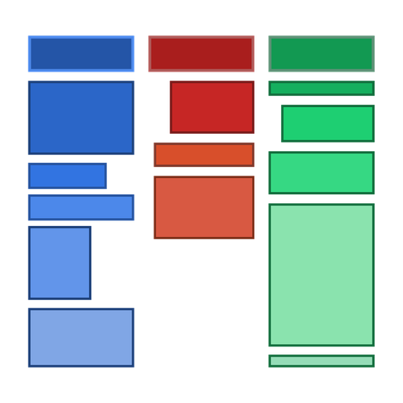

<p align="center">
  
</p>

# WidKanban

A lightweight, unobtrusive, frameless desktop Kanban widget built with **Tauri v2 (Rust)** and **React 19 + Vite + Tailwind CSS + Zustand + @dnd-kit**.

WidKanban aggregates both **GitHub Issues/PRs** and **Google Tasks** into a single, unified 3-column Kanban view (*To Do*, *In Progress*, *Done*) sitting directly on your desktop layer.

> *So, if you ever want to look at your unified kanban, do it widkanban!*

---

## Table of Contents

- [Key Features](#key-features)
- [Tech Stack](#tech-stack)
- [Quick Start & Local Development](#quick-start--local-development)
  - [Prerequisites](#prerequisites)
  - [Installation & Running](#installation--running)
  - [Building Binaries](#building-binaries)
- [API Configuration & Credentials](#api-configuration--credentials)
  - [GitHub Personal Access Token](#github-personal-access-token)
  - [Google Tasks OAuth Token](#google-tasks-oauth-token)
  - [Security & Local Storage](#security--local-storage)
- [Documentation & Deep Dives](#documentation--deep-dives)
- [Project Roadmap](#project-roadmap)
- [Contributing](#contributing)

---

## Key Features

- **Desktop Widget Design**: Frameless window (`decorations: false`), transparent backdrop, floating pin mode (`alwaysOnTop`), and hidden from taskbar. See [Frameless Window Notes](docs/notes.md#2-frameless-window--drag-region-behavior).
- **System Tray Controls**: Quick access via native tray icon (**Show/Hide Widget**, **Toggle Always on Top**, **Quit**). See [Architecture Specification](docs/architecture.md#1-high-level-system-architecture).
- **Unified Provider Aggregator**: Unified view combining assigned GitHub Issues/PRs and Google Tasks. See [Data Normalization Schema](docs/architecture.md#2-data-normalization-schema).
- **Rich Task Details**: Inspect PR branch comparison, fork status, draft badges, diff statistics (`+`/`-`), assignees, author avatars, and milestone deadlines. See [Schema Details](docs/architecture.md#2-data-normalization-schema).
- **Drag-and-Drop Kanban**: Smooth, accessible drag-and-drop powered by `@dnd-kit` with instant 60fps optimistic UI updates and background API write-backs. See [Sync Model & Write-Back Engine](docs/architecture.md#4-sync-model--write-back-engine).
- **Issue Deletion & Local Trash Management**: Choose between hiding issues locally or closing/permanently deleting them on GitHub, with a quick-restore dropdown. See [Task Deletion Architecture](docs/architecture.md#5-task-deletion--local-trash-management).
- **Secure Architecture**: OAuth tokens & PATs stored natively in Rust OS storage—never exposed to frontend JavaScript or browser storage. See [Security Model](docs/architecture.md#3-security--token-storage-model) and [Credentials Storage](docs/credentials-setup.md#where-credentials-are-stored).
- **Ultra Lightweight**: Low memory footprint (~30–50 MB RAM at idle) powered by Tauri v2. See [Performance Profile](docs/notes.md#4-performance--memory-profile).

[↑ Back to Top](#table-of-contents)

---

## Tech Stack

| Layer | Technology | Documentation & Resources |
| :--- | :--- | :--- |
| **Desktop Framework** | [Tauri v2](https://v2.tauri.app/) (Rust 2021) | [System Architecture](docs/architecture.md#1-high-level-system-architecture) |
| **Frontend Framework** | React 19 + TypeScript + Vite | [Component Overview](docs/architecture.md#1-high-level-system-architecture) |
| **State Management** | [Zustand](https://github.com/pmndrs/zustand) | [Sync & Write-Back Model](docs/architecture.md#4-sync-model--write-back-engine) |
| **Drag & Drop** | [@dnd-kit](https://dndkit.com/) (`core`, `sortable`, `utilities`) | [Board Design](docs/architecture.md#1-high-level-system-architecture) |
| **Styling & Icons** | Tailwind CSS + Lucide Icons + Glassmorphism | [Window Styling](docs/notes.md#2-frameless-window--drag-region-behavior) |

[↑ Back to Top](#table-of-contents)

---

## Quick Start & Local Development

### Prerequisites

#### Node.js & Rust
- Node.js >= 18
- Rust toolchain (`cargo`, `rustc`)

#### Windows Linker
- Requires the MSVC C++ build tools (`link.exe`) for `reqwest` and `tokio`. If missing, follow the [Windows MSVC Linker Guide](docs/notes.md#5-windows-msvc-linker-required-for-reqwest--tokio).

#### Linux System Dependencies (Ubuntu / Debian / WSL)
If running on Linux or WSLg, install GTK3, WebKit2GTK, and libayatana:
```bash
sudo apt-get update
sudo apt-get install -y \
  libgtk-3-dev \
  libgdk-pixbuf2.0-dev \
  libwebkit2gtk-4.1-dev \
  libsoup-3.0-dev \
  libayatana-appindicator3-1 \
  libayatana-appindicator3-dev
```
For more details on Linux display behavior and troubleshooting, see [Linux Environment Prerequisites](docs/notes.md#1-linux-environment-prerequisites).

### Installation & Running

1. **Clone the repository and install dependencies**:
   ```bash
   git clone https://github.com/Dowiw/widkanban.git
   cd widkanban
   npm install
   ```

2. **Run in browser preview mode (Vite)**:
   ```bash
   npm run dev
   # Opens http://localhost:1420
   ```

3. **Launch native desktop widget mode (Tauri v2)**:
   ```bash
   npm run tauri dev
   ```

### Building Binaries

To compile native release binaries and installers into the `./bin/` directory:
```bash
npm run build:bin
```
This produces `.exe` / `.msi` (Windows), `.AppImage` / `.deb` (Linux), or `.app` / `.dmg` (macOS) packages ready for deployment.

[↑ Back to Top](#table-of-contents)

---

## API Configuration & Credentials

WidKanban connects directly to GitHub and Google Tasks APIs from the native Rust backend. You can input your credentials inside the widget settings modal (accessed via the **Settings (⚙)** icon in the header).

### GitHub Personal Access Token
- Supports both **Fine-Grained Tokens** (recommended: `Issues: Read & Write`, `Pull Requests: Read-only`) and **Classic Tokens** (`repo`, `read:user`).
- Step-by-step setup instructions: [GitHub PAT Setup Guide](docs/credentials-setup.md#1-github--personal-access-token-pat).

### Google Tasks OAuth Token
- Requires scope `https://www.googleapis.com/auth/tasks`.
- Contributors can test in under 60 seconds with **ephemeral 1-hour tokens** from Google OAuth Playground (no Google Cloud Console project needed!).
- Step-by-step instructions: [Google Tasks OAuth Guide](docs/credentials-setup.md#2-google-tasks--oauth-20-access-token) and [Contributor Ephemeral Quick-Start](docs/credentials-setup.md#contributor-quick-start-fast-testing-with-short-lived-keys).

### Security & Local Storage
- **Zero Frontend Secrets**: Tokens are never saved in `localStorage`, `sessionStorage`, or frontend state.
- **Native OS Storage**: Saved strictly in `%APPDATA%\com.widkanban.desktop\credentials.json` on Windows (or `~/.local/share/com.widkanban.desktop/credentials.json` with `0600` permissions on Unix).
- Full security details: [Security Model](docs/architecture.md#3-security--token-storage-model) and [Credentials Storage Locations](docs/credentials-setup.md#where-credentials-are-stored).

[↑ Back to Top](#table-of-contents)

---

## Documentation & Deep Dives

Detailed technical documentation is maintained in the [`docs/`](./docs/) directory:

| Document | Description | Key Topics |
| :--- | :--- | :--- |
| 🤝 **[Contributor Guide & Manual](CONTRIBUTORS.md)** | Full guide for development workflows, fast testing with ephemeral keys, and PR checklists. | [Architectural invariants](CONTRIBUTORS.md#2-non-negotiable-architectural-invariants), [Dev setup](CONTRIBUTORS.md#3-prerequisites--development-environment-setup), [Ephemeral keys](CONTRIBUTORS.md#4-fast-testing-with-ephemeral--short-lived-keys), [PR checklist](CONTRIBUTORS.md#8-pull-request--verification-checklist). |
| 🔑 **[Credentials Setup Guide](docs/credentials-setup.md)** | Step-by-step instructions for generating GitHub PATs and Google OAuth tokens. | Token scopes, [Contributor quick-start](docs/credentials-setup.md#contributor-quick-start-fast-testing-with-short-lived-keys), [Local storage paths](docs/credentials-setup.md#where-credentials-are-stored), [Revocation](docs/credentials-setup.md#revoking-credentials). |
| 🏛️ **[Architecture & System Design](docs/architecture.md)** | Core system architecture, IPC bridge, security invariants, and schemas. | [Mermaid architecture diagram](docs/architecture.md#1-high-level-system-architecture), [`UnifiedTask` schema](docs/architecture.md#2-data-normalization-schema), [Write-back engine](docs/architecture.md#4-sync-model--write-back-engine), [Local trash system](docs/architecture.md#5-task-deletion--local-trash-management). |
| 🛠️ **[Developer Notes & Troubleshooting](docs/notes.md)** | Implementation quirks, frameless window behavior, and compiler troubleshooting. | [Linux packages](docs/notes.md#1-linux-environment-prerequisites), [Frameless drag region](docs/notes.md#2-frameless-window--drag-region-behavior), [Console warnings](docs/notes.md#3-understanding-common-console-warnings), [MSVC linker fix](docs/notes.md#5-windows-msvc-linker-required-for-reqwest--tokio). |
| 🗺️ **[Roadmap & Feature TODOs](docs/todos.md)** | Development progress, milestone checklists, and planned upcoming features. | [Completed features](docs/todos.md#completed-capabilities), [Upcoming roadmap](docs/todos.md#upcoming--planned-features). |

[↑ Back to Top](#table-of-contents)

---

## Project Roadmap & Status

### Completed & Supported ✅
- **Desktop Widget**: Frameless glassmorphic window, tray controls, `@dnd-kit` drag-and-drop, quick add task modal.
- **GitHub Integration**: Assigned issues & PR fetching, rich PR branch comparisons, diff stats, label synchronization, and remote/local issue deletion.
- **Google Tasks Integration**: OAuth token support, multi-list tasks sync, subtasks & links normalization, completion status write-back.

### Planned & Upcoming 🎯
- **Background Sync Engine**: Tokio background polling loop (~3 min cadence) and native desktop notifications on assignment.
- **Distribution Packages**: Standalone `.msi` / `.exe` (Windows), `.AppImage` / `.deb` (Linux), and `.dmg` (macOS) installers.
- **In-App OAuth Loopback**: Built-in local HTTP callback server for frictionless Google Tasks authentication.

Track our full feature checklist in the [Roadmap & Feature Checklist](docs/todos.md).

[↑ Back to Top](#table-of-contents)

---

## Contributing

We welcome contributions of all kinds! Please consult our comprehensive **[Contributor Guide & Development Manual](CONTRIBUTORS.md)** before opening an issue or pull request. It includes:
- Non-negotiable architectural invariants (zero frontend secrets, data normalization).
- Fast contributor testing workflows with 1-hour ephemeral keys (no Google Cloud project required).
- Development server modes, test commands (`npm test`, `cargo test`), and build steps.
- Code conventions and PR verification checklist.

[↑ Back to Top](#table-of-contents)
