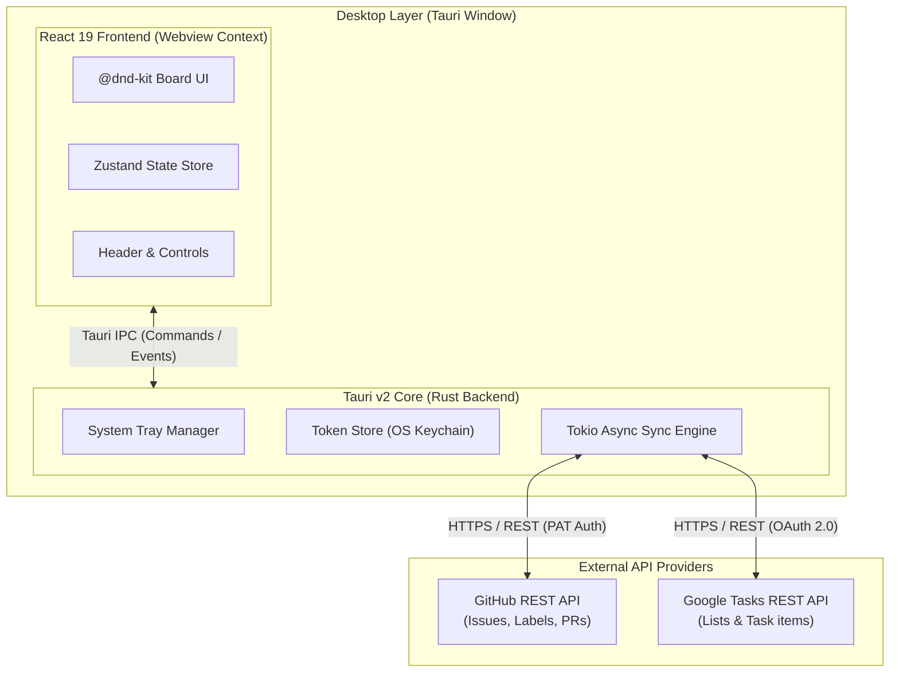

# WidKanban Architecture & System Design

This document details the architectural design, security model, data schemas, and Tauri IPC integration for **WidKanban**.

---

## Table of Contents

- [1. High-Level System Architecture](#1-high-level-system-architecture)
- [2. Data Normalization Schema](#2-data-normalization-schema)
- [3. Security & Token Storage Model](#3-security--token-storage-model)
- [4. Sync Model & Write-Back Engine](#4-sync-model--write-back-engine)
- [5. Task Deletion & Local Trash Management](#5-task-deletion--local-trash-management)
- [Related Documentation](#related-documentation)

---

## 1. High-Level System Architecture



---

## 2. Data Normalization Schema

All tasks fetched from disparate external providers (GitHub Issues/PRs, Google Tasks) are normalized into a unified TypeScript interface:

```typescript
export type TaskSource = 'github' | 'google_tasks';
export type TaskStatus = 'todo' | 'in_progress' | 'done';

export interface GitHubLabel {
  name: string;
  color: string;       // 6-char hex code from GitHub (e.g. "d73a4a")
  description?: string;
}

export interface PRBranchInfo {
  headRef: string;     // e.g. "feat/branch-compare"
  baseRef: string;     // e.g. "main"
  isFork?: boolean;    // true if PR originated from an external fork
  headRepo?: string;   // e.g. "contributor/widkanban"
  isDraft?: boolean;
  additions?: number;
  deletions?: number;
  changedFiles?: number;
}

export interface UnifiedTask {
  id: string;             // Unique identifier, e.g., 'gh_102' or 'gt_abc123'
  title: string;          // Human-readable task title
  source: TaskSource;     // 'github' | 'google_tasks'
  status: TaskStatus;     // 'todo' | 'in_progress' | 'done'
  url: string;            // Direct web URL to the issue or task item
  updatedAt: string;      // ISO 8601 timestamp
  description?: string;   // Markdown body or task notes
  sourceMeta: {
    // --- Google Tasks ---
    listId?: string;
    listTitle?: string;
    notes?: string;
    dueDate?: string;            // RFC 3339 timestamp
    parentId?: string;
    hasSubtasks?: boolean;
    subtaskCount?: number;
    subtasks?: SubtaskItem[];
    links?: TaskLink[];

    // --- GitHub ---
    repo?: string;               // e.g. "owner/repo"
    issueNumber?: number;
    isPullRequest?: boolean;     // PR vs Issue badge differentiation
    commentsCount?: number;
    milestone?: { title: string; dueOn?: string };
    author?: TaskUser;
    assignees?: TaskUser[];
    labels?: GitHubLabel[];
    branchInfo?: PRBranchInfo;   // Branch, fork, draft status, and diff statistics
  };
}
```

---

## 3. Security & Token Storage Model

> [!IMPORTANT]
> OAuth tokens and Personal Access Tokens (PATs) are **never** passed into or stored within the frontend JavaScript webview context to prevent XSS leak vectors.

1. **Rust Keychain Layer**: Auth tokens are encrypted and managed natively in Rust via OS Keychain services or `tauri-plugin-store`.
2. **IPC Scoping**: The frontend webview only sends IPC requests like `invoke('sync_tasks')` or `invoke('update_task_status', { taskId, status })`.
3. **No Direct Web Fetch for Auth**: All API network calls to GitHub and Google Tasks are executed inside Rust `reqwest` / async threads.

---

## 4. Sync Model & Write-Back Engine

- **Optimistic UI**: Moving a card in `@dnd-kit` immediately mutates local Zustand store state for instant visual feedback.
- **Async Write-back**: React invokes a Rust IPC command in the background:
  - **GitHub Write-back**: Moving to *Done* closes the issue (`PATCH /repos/{owner}/{repo}/issues/{number}`). Moving to *In Progress* applies an `in-progress` label.
  - **Google Tasks Write-back**: Moving to *Done* sets task status to `completed` (`PATCH /tasks/v1/lists/{listId}/tasks/{taskId}`).
- **Tokio Background Polling Loop**: A background thread polls APIs every ~3 minutes and emits a `tasks-updated` event to the webview.

---

## 5. Task Deletion & Local Trash Management

WidKanban provides a flexible two-tier deletion system for external tasks (GitHub Issues):

1. **Delete Locally Only**:
   - The task is removed from the visible Kanban columns and preserved in `locallyDeletedTasks` in the Zustand store.
   - Subsequent GitHub background polls and syncs filter out locally hidden tasks so they do not reappear unprompted.
   - Users can view and **restore** locally deleted tasks at any time via the Trash dropdown in the widget header.
   - A subtle, one-time dismissible banner informs users when remote issues have been kept hidden locally.

2. **Delete on GitHub**:
   - **Close Issue (Standard)**: Dispatches `close_github_issue` via Tauri IPC. The issue is marked `closed` with `state_reason: "not_planned"` (and an optional explanation or duplicate link comment). Does not require repository admin privileges.
   - **Permanently Delete (Admin)**: Dispatches `delete_github_issue_permanently` via the GitHub GraphQL `deleteIssue` mutation. Requires repository admin/owner permissions.
   - **Preferences**: Users can choose to remember their deletion mode or reset their preference anytime in Settings.

---

## Related Documentation

- [Project README](../README.md): Overview, key features, and quick start.
- [Credentials Setup Guide](credentials-setup.md): Guide for GitHub PAT and Google Tasks OAuth configuration.
- [Developer Notes](notes.md): Environment dependencies, frameless window behavior, and MSVC setup.
- [Roadmap & TODOs](todos.md): Milestone progress and feature breakdown for upcoming phases.
