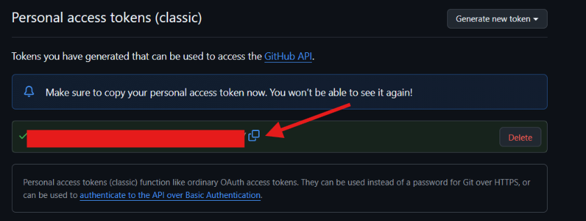
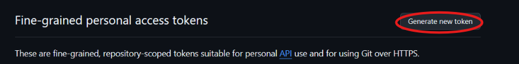
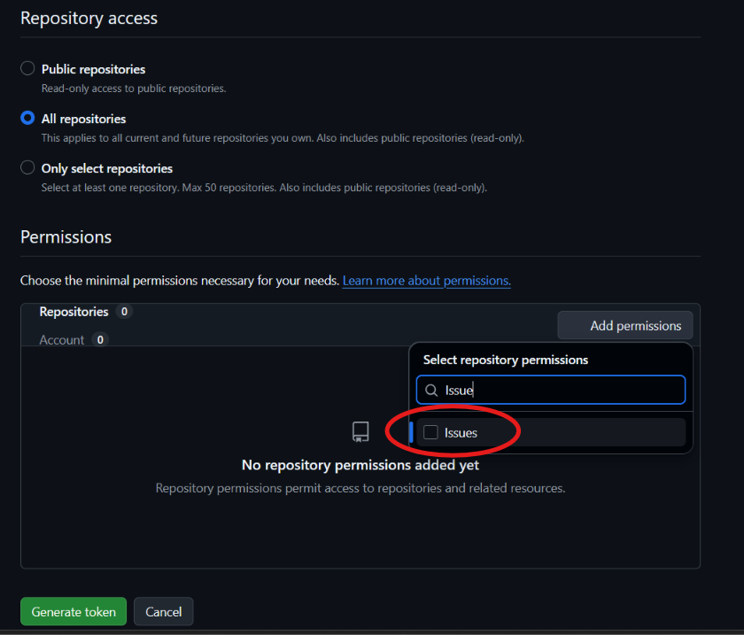
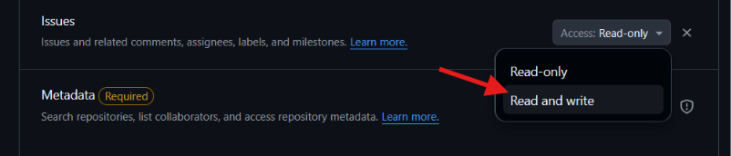
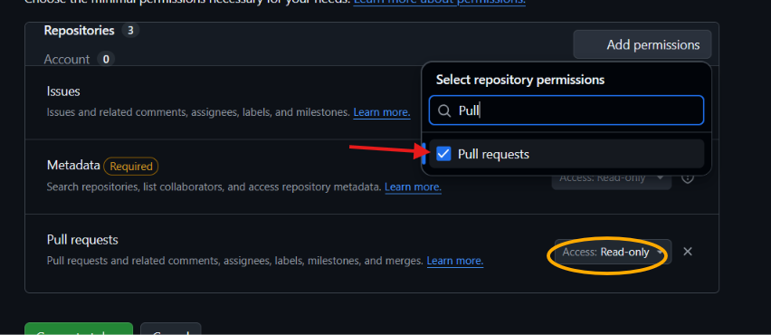
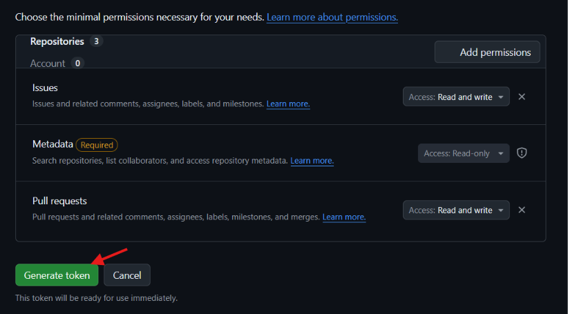
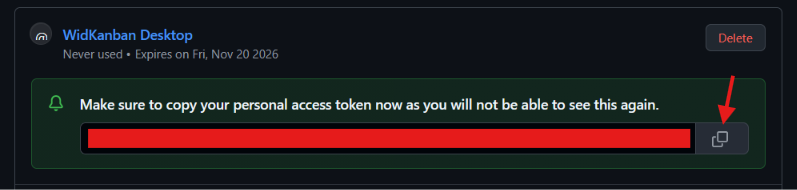

# WidKanban — GitHub Setup Guide

This guide walks you through generating a **GitHub Personal Access Token (PAT)** and connecting it to WidKanban so you can view, drag-and-drop, label, and close your assigned GitHub Issues and Pull Requests.

> [!NOTE]
> WidKanban **never** stores tokens in your browser or frontend state. Your token is transmitted directly to the native Rust backend and saved securely in local OS storage (`credentials.json`) with restricted file permissions (`600`).

> **Status**: Verified & Active  
> **Last Updated**: October 2026 (Verified with current GitHub UI)

---

## Table of Contents

- [Comparison: Classic vs. Fine-Grained PATs](#comparison-classic-vs-fine-grained-personal-access-tokens)
- [Required Scopes Overview](#required-scopes-overview)
- [Option 1: Classic Personal Access Token (Recommended)](#option-1-classic-personal-access-token-recommended)
- [Option 2: Fine-Grained Personal Access Token (Beta)](#option-2-fine-grained-personal-access-token-beta)
- [Connecting GitHub in WidKanban](#connecting-github-in-widkanban)
- [Auto-Sync & Rate Limit Monitoring](#auto-sync--rate-limit-monitoring)
- [Troubleshooting & FAQ](#troubleshooting--faq)

---

## Comparison: Classic vs. Fine-Grained Personal Access Tokens

GitHub offers two types of Personal Access Tokens. Both formats (`ghp_...` and `github_pat_...`) are fully supported by WidKanban:

| Feature / Dimension | Classic PAT (`ghp_...`) | Fine-Grained PAT (`github_pat_...`) |
| :--- | :--- | :--- |
| **Repository Scope** | **Account-Wide**: Grants access across **all** repositories you own or collaborate on. | **Targeted**: Can be restricted to specific individual repositories or all repositories. |
| **Permission Granularity** | **Coarse**: The `repo` scope grants full read/write to everything (code, releases, PRs, issues). | **Granular**: Configured per sub-resource (e.g. only `Issues: Read & Write` and `Pull requests: Read & Write`). |
| **Maximum Expiration** | **Flexible / Unlimited**: Can choose `No expiration`, 30, 60, or 90 days. | **1 Year Hard Cap**: Cannot exceed 365 days (must be rotated at least once per year). |
| **Organization Policies** | Often blocked or restricted by enterprise security policies. | **Enterprise-Friendly**: Organization owners can review, approve, or revoke tokens per repository. |
| **Security Blast Radius** | **Higher**: If leaked, grants full access to repository source code and settings. | **Minimal**: Only grants access to the specific resources you selected (e.g., issues only). |
| **Best Choice For** | **Fast Personal Setup**: Recommended if you want a quick 1-minute setup across all your projects without expiration limits. | **Enterprise / Sensitive Repos**: Recommended if you work with organization repositories requiring least-privilege security. |

---

## Required Scopes Overview

WidKanban requests only the minimal scopes required to query assigned issues and synchronize statuses:

| Scope | Permission Level | Why It Is Needed |
| :--- | :--- | :--- |
| `repo` | Full control of private repositories | Read and update issues, PRs, and labels in private repositories you access |
| `public_repo` | Public repositories only | Read and update issues in public repositories (sufficient if you only use public repos) |
| `read:user` | Read user profile data | Identifies which issues and PRs are assigned to your authenticated user account |

---

## Option 1: Classic Personal Access Token (Recommended)

### Step 1: Open GitHub Developer Settings
1. Log into your GitHub account.
2. In the top-right corner, click your profile avatar and select **Settings**.
3. In the left navigation menu, scroll down to the bottom and click **Developer settings**.
4. Select **Personal access tokens** → **Tokens (classic)**.
   - *Direct link*: [https://github.com/settings/tokens](https://github.com/settings/tokens)

---

### Step 2: Generate New Token (classic)
1. Click the **Generate new token** dropdown in the top-right and select **Generate new token (classic)**.
2. If prompted, confirm your GitHub password or two-factor authentication (2FA).

---

### Step 3: Configure Token Expiration and Scopes
1. **Note**: Give your token a recognizable name (e.g., `WidKanban Desktop`).
2. **Expiration**: Choose an expiration interval:
   - `30 days` or `90 days` (recommended by GitHub for security)
   - `No expiration` (if you do not want to rotate tokens periodically)
3. **Select scopes**:
   - Check `repo` (Full control of private repositories, commit status, and issue labels).
   - Check `read:user` (Under *User*, grants read access to identify your assigned issues and PRs).

---

### Step 4: Generate and Copy Your Token
1. Scroll down to the bottom of the page and click the green **Generate token** button.

2. Click the copy icon next to your newly generated token starting with `ghp_...`.

> [!WARNING]
> Copy the token immediately! GitHub will never display it again after you navigate away from this page.

---

## Option 2: Fine-Grained Personal Access Token (Beta)

Fine-grained personal access tokens allow you to restrict WidKanban's access to only issues and pull requests while keeping your source code protected.

### Step 1: Open Fine-Grained Tokens
1. Go to **Settings** → **Developer settings** → **Personal access tokens** → **Fine-grained tokens**.
   - *Direct link*: [https://github.com/settings/tokens?type=beta](https://github.com/settings/tokens?type=beta)
2. Click the **Generate new token** button in the top right.

---

### Step 2: Configure Name, Expiration & Repository Access
1. **Token name**: Enter `WidKanban Desktop`.
2. **Expiration**: Select your preferred expiration (up to 365 days).
3. **Repository access**: Choose **All repositories** (or select specific repositories).
4. Under **Permissions**, click **Add permissions** and search for **Issues**.

---

### Step 3: Configure Issues Permissions
1. Under **Issues**, change the Access dropdown from `Read-only` to **Read and write**.
   - *Why*: Allows WidKanban to read assigned issues, update `in-progress` labels, and close issues when moved to Done.

---

### Step 4: Configure Pull Requests Permissions
1. Under **Permissions**, search for **Pull requests**.
2. Set Access to **Read and write** (or `Read-only` if you do not want WidKanban applying labels to PRs).
   - *Note*: `Metadata: Read-only` is automatically required and selected by GitHub.

---

### Step 5: Review Permissions & Generate Token
1. Review the permissions summary:
   - **Issues**: `Access: Read and write`
   - **Metadata (Required)**: `Access: Read-only`
   - **Pull requests**: `Access: Read and write`
2. Scroll to the bottom and click the green **Generate token** button.

---

### Step 6: Copy the Generated Token
1. Click the copy icon next to your new token starting with `github_pat_...`.

> [!WARNING]
> Copy the token immediately! GitHub will never display it again after you leave this page.

---

## Connecting GitHub in WidKanban

### Step 1: Open Settings in WidKanban
1. In the WidKanban header, click the **Settings (gear icon)** in the top right.
2. Select the **Integrations** tab.
3. In the **GitHub Personal Access Token** field, paste your `ghp_...` (or `github_pat_...`) token.

### Step 2: Save Credentials
1. Click **Save Credentials** at the bottom right.
2. The badge will switch to Connected.
3. WidKanban will immediately fetch your assigned open issues and render them onto the **To Do** / **In Progress** columns.

---

## Auto-Sync & Rate Limit Monitoring

1. In WidKanban Settings, switch to the **Auto-Sync & Quota** tab.
2. You can view:
   - **Background Auto-Sync**: Toggle automatic polling (1, 3, 5, or 15 minutes).
   - **Hourly Request Quota**: Visual progress bar showing remaining GitHub API calls (5,000 requests/hour free tier).
   - **Token Expiration**: Displays the exact expiration date and countdown extracted directly from GitHub headers.
   - **Smart Rate-Limit Back-Off**: Automatic pause protection whenever your hourly quota is exhausted.

---

## Troubleshooting & FAQ

### 1. "Bad credentials" (HTTP 401)
- Verify you copied the entire token without extra spaces or line breaks.
- Check if your token has expired in [GitHub Token Settings](https://github.com/settings/tokens).

### 2. Issues from my organization repository are not appearing
- If your organization enforces **SAML SSO**, you must authorize the token:
  1. In [GitHub Token Settings](https://github.com/settings/tokens), locate your token.
  2. Click **Configure SSO** next to the token and click **Authorize** for your organization.
- For fine-grained tokens, an organization administrator may need to approve the token under **Organization Settings → Personal Access Tokens → Pending Requests**.

### 3. How do I disconnect or rotate my token?
- Click the **Trash icon** next to GitHub in WidKanban Settings to delete the token from local storage.
- Generate a new token in GitHub and paste it into WidKanban.
