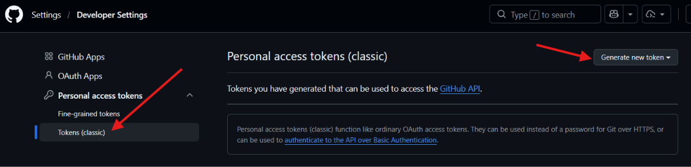
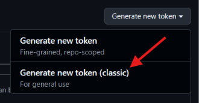
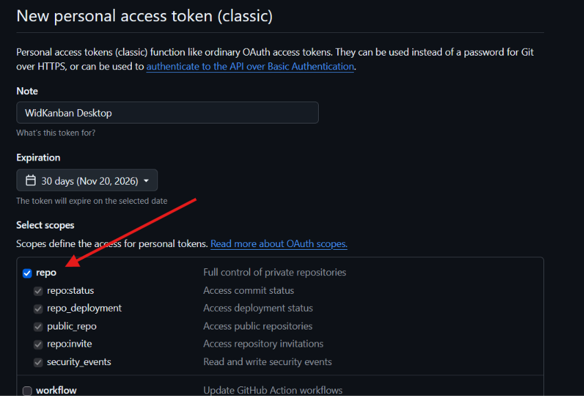
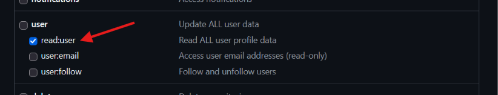
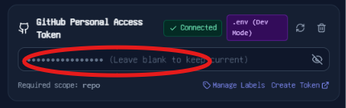

# WidKanban — GitHub Setup Guide

This guide walks you through generating a **GitHub Personal Access Token (PAT)** and connecting it to WidKanban so you can view, drag-and-drop, label, and close your assigned GitHub Issues and Pull Requests.

> [!NOTE]
> WidKanban **never** stores tokens in your browser or frontend state. Your token is transmitted directly to the native Rust backend and saved securely in local OS storage (`credentials.json`) with restricted file permissions (`600`).

---

## Table of Contents

- [Required Scopes Overview](#required-scopes-overview)
- [Option 1: Classic Personal Access Token (Recommended)](#option-1-classic-personal-access-token-recommended)
- [Option 2: Fine-Grained Personal Access Token (Beta)](#option-2-fine-grained-personal-access-token-beta)
- [Connecting GitHub in WidKanban](#connecting-github-in-widkanban)
- [Auto-Sync & Rate Limit Monitoring](#auto-sync--rate-limit-monitoring)
- [Troubleshooting & FAQ](#troubleshooting--faq)

---

## Required Scopes Overview

WidKanban requests only the minimal scopes required to query assigned issues and synchronize statuses:

| Scope | Permission Level | Why It Is Needed |
| :--- | :--- | :--- |
| `repo` | Full control of private repositories | Read and update issues, PRs, and labels in private repositories you access |
| `public_repo` | Public repositories only | Read and update issues in public repositories (sufficient if you only use public repos) |
| `read:user` | Read user profile data | Identifies which issues and PRs are assigned to your authenticated user account |

---

## Option 1: Classic Personal Access Token (Recommended)

### Step 1: Open GitHub Developer Settings
1. Log into your GitHub account.
2. In the top-right corner, click your profile avatar and select **Settings**.
3. In the left navigation menu, scroll down to the bottom and click **Developer settings**.
4. Select **Personal access tokens** → **Tokens (classic)**.
   - *Direct link*: [https://github.com/settings/tokens](https://github.com/settings/tokens)

---

### Step 2: Generate New Token (classic)
1. Click the **Generate new token** dropdown in the top-right and select **Generate new token (classic)**.
2. If prompted, confirm your GitHub password or two-factor authentication (2FA).

---

### Step 3: Configure Token Expiration and Scopes
1. **Note**: Give your token a recognizable name (e.g., `WidKanban Desktop`).
2. **Expiration**: Choose an expiration interval:
   - `30 days` or `90 days` (recommended by GitHub for security)
   - `No expiration` (if you do not want to rotate tokens periodically)
3. **Select scopes**:
   - Check `repo` (Full control of private repositories, commit status, and issue labels).
   - Check `read:user` (Under *User*, grants read access to identify your assigned issues and PRs).

---

### Step 4: Generate and Copy Your Token
1. Scroll down to the bottom of the page and click the green **Generate token** button.

2. Copy the generated token starting with `ghp_...`.

> [!WARNING]
> Copy the token immediately! GitHub will never display it again after you navigate away from this page.

---

## Option 2: Fine-Grained Personal Access Token (Beta)

If your organization requires **fine-grained permissions** instead of classic tokens:

1. Navigate to **Developer settings** → **Personal access tokens** → **Fine-grained tokens**.
   - *Direct link*: [https://github.com/settings/tokens?type=beta](https://github.com/settings/tokens?type=beta)
2. Click **Generate new token**.
3. Set **Token name** to `WidKanban Desktop` and choose an **Expiration** (up to 365 days).
4. **Repository access**: Select **All repositories** or pick the specific repositories you want displayed on your Kanban board.
5. **Repository permissions**:
   - **Issues**: Select `Read and write` (to query issues, update labels, and close issues).
   - **Pull requests**: Select `Read and write` (or `Read-only` if not updating PR labels).
   - **Metadata**: Automatically set to `Read-only`.
6. Click **Generate token** and copy the `github_pat_...` token.

<!-- SCREENSHOT PLACEHOLDER: Fine-Grained Permissions Configuration -->

---

## Connecting GitHub in WidKanban

### Step 1: Open Settings in WidKanban
1. In the WidKanban header, click the **Settings (gear icon)** in the top right.
2. Select the **Integrations** tab.
3. In the **GitHub Personal Access Token** field, paste your `ghp_...` token.

### Step 2: Save Credentials
1. Click **Save Credentials** at the bottom right.
2. The badge will switch to Connected.
3. WidKanban will immediately fetch your assigned open issues and render them onto the **To Do** / **In Progress** columns.

<!-- SCREENSHOT PLACEHOLDER: Connected GitHub Badge in WidKanban -->

---

## Auto-Sync & Rate Limit Monitoring

1. In WidKanban Settings, switch to the **Auto-Sync & Quota** tab.
2. You can view:
   - **Background Auto-Sync**: Toggle automatic polling (1, 3, 5, or 15 minutes).
   - **Hourly Request Quota**: Visual progress bar showing remaining GitHub API calls (5,000 requests/hour free tier).
   - **Token Expiration**: Displays the exact expiration date and countdown extracted directly from GitHub headers.
   - **Smart Rate-Limit Back-Off**: Automatic pause protection whenever your hourly quota is exhausted.

<!-- SCREENSHOT PLACEHOLDER: Auto-Sync & Quota Tab for GitHub -->

---

## Troubleshooting & FAQ

### 1. "Bad credentials" (HTTP 401)
- Verify you copied the entire token without extra spaces or line breaks.
- Check if your token has expired in [GitHub Token Settings](https://github.com/settings/tokens).

### 2. Issues from my organization repository are not appearing
- If your organization enforces **SAML SSO**, you must authorize the token:
  1. In [GitHub Token Settings](https://github.com/settings/tokens), locate your token.
  2. Click **Configure SSO** next to the token and click **Authorize** for your organization.

### 3. How do I disconnect or rotate my token?
- Click the **Trash icon** next to GitHub in WidKanban Settings to delete the token from local storage.
- Generate a new token in GitHub and paste it into WidKanban.
