# WidKanban — Google Tasks OAuth Setup Guide

This guide walks you through setting up a **Google Cloud OAuth 2.0 Client** to enable native 1-click **"Sign in with Google"** and **silent background token refresh** in WidKanban.

> [!NOTE]
> WidKanban uses a native local loopback server (`http://127.0.0.1:<PORT>`) to capture your Google authorization response directly. Tokens are stored exclusively in native OS storage (`credentials.json`) and never exposed to browser context.

> **Status**: Verified & Active  
> **Last Updated**: October 2026 (Verified with current Google Cloud Platform & Auth UI)

---

## Table of Contents

- [Why OAuth 2.0 & Desktop Client?](#why-oauth-20--desktop-client)
- [Part 1: Create Project & Enable Google Tasks API](#part-1-create-project--enable-google-tasks-api)
- [Part 2: Configure OAuth Consent Screen & Test Users (Crucial)](#part-2-configure-oauth-consent-screen--test-users-crucial)
- [Part 3: Create Desktop OAuth Client Credentials](#part-3-create-desktop-oauth-client-credentials)
- [Part 4: 1-Click "Sign in with Google" in WidKanban](#part-4-1-click-sign-in-with-google-in-widkanban)
- [Part 5: Silent Auto-Refresh & Quota Monitoring](#part-5-silent-auto-refresh--quota-monitoring)
- [Troubleshooting & FAQ](#troubleshooting--faq)

---

## Why OAuth 2.0 & Desktop Client?

- **No Expiring Tokens**: Standard Google access tokens (`ya29...`) expire after exactly 60 minutes. WidKanban's native loopback flow captures a permanent `refresh_token` (`1//...`), allowing WidKanban to renew tokens silently in the background forever without prompting you again.
- **Why "Desktop app" is Required**: Google Cloud strictly prohibits dynamic localhost ports for "Web application" clients, but explicitly permits loopback IP redirects (`http://127.0.0.1:<PORT>`) on any port for **Desktop apps**.

---

## Part 1: Create Project & Enable Google Tasks API

### Step 1: Open Google Cloud Console
1. Navigate to the [Google Cloud Console](https://console.cloud.google.com/).
2. Log in with the Google account whose tasks you want to synchronize.
3. In the top project dropdown, select an existing project or click **New project**.

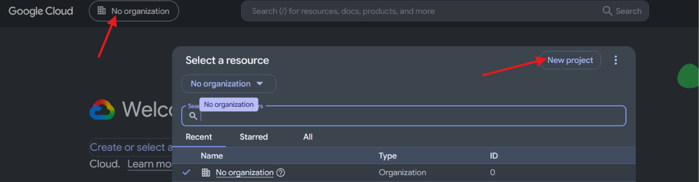

4. Enter a descriptive **Project name** (e.g. `widkanban-widget`) and click **Create**.

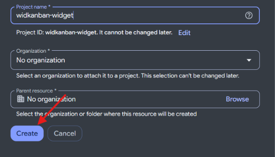

---

### Step 2: Enable the Google Tasks API
1. Select your new project (`widkanban-widget`) from the top bar, then open the left navigation menu.

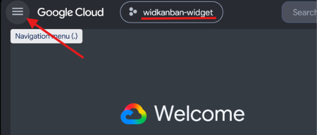

2. In the navigation menu, go to **APIs & Services** → **Enabled APIs & services**.

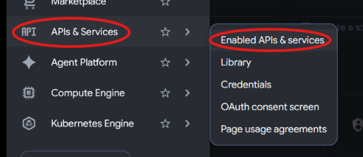

3. Click **+ Enable APIs and services** at the top.

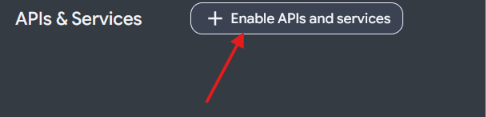

4. Search for **Google Tasks** in the API library and select **Google Tasks API**.

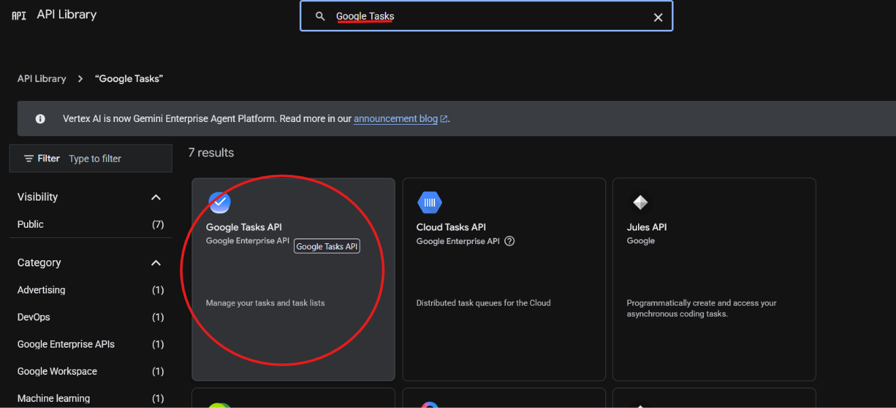

5. Click the blue **Enable** button.

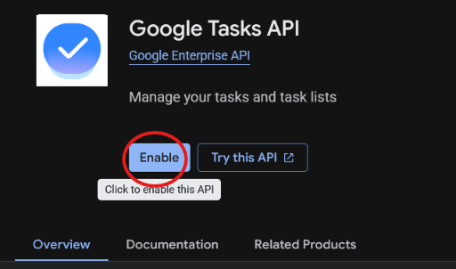

---

## Part 2: Configure OAuth Consent Screen & Test Users (Crucial)

### Step 3: Configure Consent Screen
1. In the left navigation, select **APIs & Services** → **OAuth consent screen**.

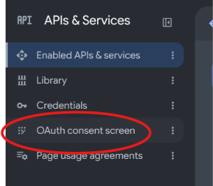

2. If Google Auth Platform is not configured yet, click **Get started**.

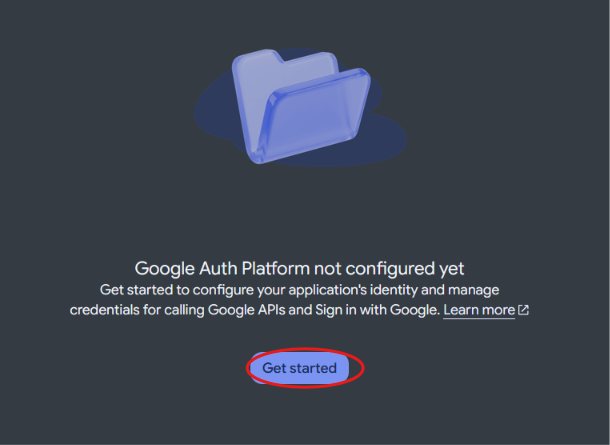

3. Under **Audience**, select **External** user type and click **Next / Create**.

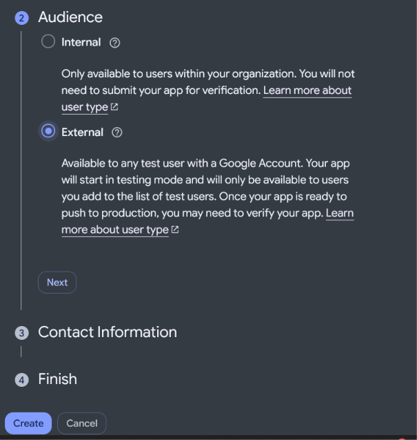

---

### Step 4: Add Yourself as a Test User (Prevents Error 403)

> [!IMPORTANT]
> If your project's publishing status is **"Testing"**, Google will block any login attempt with **`Error 403: access_denied`** unless your email address is registered as an authorized test user!

1. In the left navigation, click **Audience** (or advance to the **Test users** step).
2. Under **Test users**, click **+ Add users**.

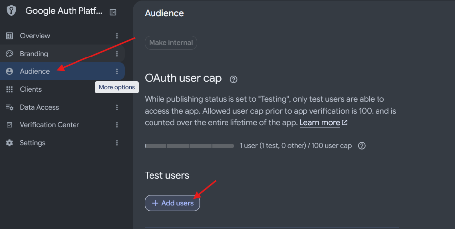

3. Enter your Google account email address (the exact email you will sign in with).
4. Click **Save**.
5. Confirm your email appears in the test users table.

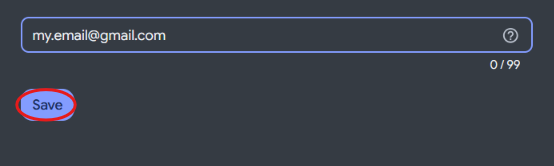

---

## Part 3: Create Desktop OAuth Client Credentials

### Step 5: Create OAuth Client ID
1. In the left navigation, go to **Clients** (or **Credentials**).
2. Click **+ Create client** (or **+ CREATE CREDENTIALS** → **OAuth client ID**).

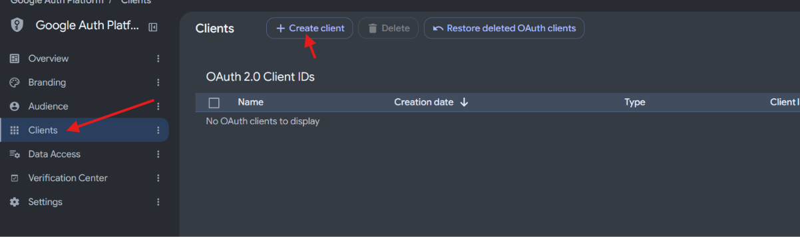

---

### Step 6: Select "Desktop app" Application Type

> [!WARNING]
> Do NOT select "Web application"! You must select **Desktop app** so Google allows dynamic loopback port redirects (`http://127.0.0.1:<PORT>`) without redirect URI mismatch errors.

1. Under **Application type**, choose **Desktop app**.
2. **Name**: `WidKanban Widget` (or any descriptive name).
3. Click **Create**.

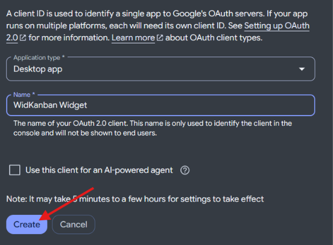

---

### Step 7: Copy Client ID and Client Secret
1. A dialog will appear displaying **OAuth client created** with your **Client ID** and **Client secret**.
2. Both values are required:
   - Click the copy button next to **Client ID** (`xxxx.apps.googleusercontent.com`).
   - Click the copy button next to **Client secret** (`GOCSPX-...`).
3. *(Optional)* Click **DOWNLOAD JSON** to keep a local backup (e.g. `client_secret_...json`).

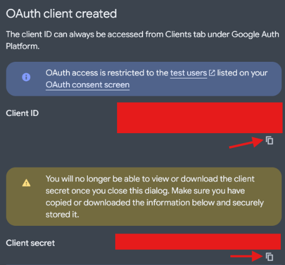

---

## Part 4: 1-Click "Sign in with Google" in WidKanban

### Step 8: Enter Credentials in WidKanban
1. Open WidKanban and click **Settings (gear icon)** → **Integrations** tab.
2. Under **Google Tasks**, click **OAuth App Settings & Setup Guide** to expand the credentials drawer.
3. Paste your **Google OAuth Client ID** and **Client Secret**.
4. Click **Save Credentials**.

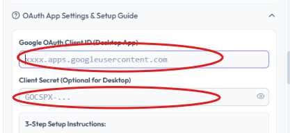

---

### Step 9: Click "Sign in with Google"
1. Click the primary **Sign in with Google (Recommended)** button.
2. WidKanban will display: *"Waiting for Google sign-in in browser..."*.
3. Your default web browser will automatically open with Google's consent screen.

---

### Step 10: Complete Authorization in Browser
1. Select your Google account.
2. If prompted with *"Google hasn't verified this app"*:
   - Click **Continue**.

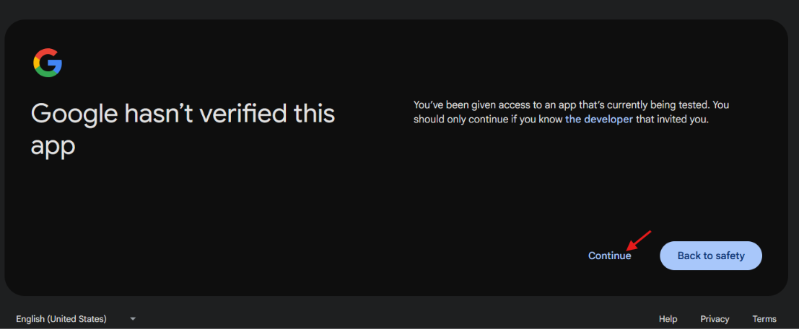

3. Review the permissions requested by WidKanban (*"Create, edit, organize, and delete all your tasks"*).
4. Click **Continue** (or *Allow*).

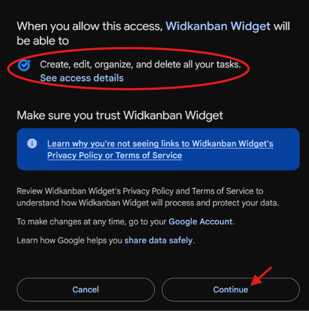

---

### Step 11: Success Confirmation
1. The browser tab will immediately load the confirmation page:
   > **WidKanban**  
   > **Authentication Successful!**  
   > *Your Google account is now connected with offline auto-refresh enabled. You can safely close this browser window and return to WidKanban.*
2. Close the browser tab and return to WidKanban.
3. WidKanban will now show <span style="color:#10b981;font-weight:600;">Connected (Auto-Refresh)</span> and your Google Tasks lists will appear on your board!

---

## Part 5: Silent Auto-Refresh & Quota Monitoring

1. Open WidKanban Settings and switch to the **Auto-Sync & Quota** tab.
2. In the **Google Tasks API & OAuth** card, verify:
   - **Status**: `Active (Auto-Refresh)`
   - **Sync Mode**: `Auto-Refresh (Persistent)`
   - **Access Token**: Countdown display showing the current 1-hour access token.
   - **Silent Auto-Refresh Notice**: Confirms that WidKanban will automatically renew expired access tokens using your stored refresh token before background sync runs.

---

## Troubleshooting & FAQ

### 1. `Error 403: access_denied`
- **Cause**: Your Google Cloud project is in "Testing" mode and your Google email is not listed in the Test Users table.
- **Fix**: Go to Google Cloud Console → **Audience** (or OAuth consent screen) → **Test users** → Click **+ Add users** → enter your email and click **Save**.

### 2. `Error 400: redirect_uri_mismatch`
- **Cause**: You selected "Web application" instead of "Desktop app" when creating your OAuth Client ID.
- **Fix**: In Google Cloud Console → **Credentials**, create a new OAuth Client ID with Application type set to **Desktop app**.

### 3. `client_secret is missing`
- **Cause**: Google strictly requires the Client Secret when exchanging the authorization code.
- **Fix**: Open WidKanban Settings → **OAuth App Settings & Setup Guide**, paste your `Client Secret` (`GOCSPX-...`), and click **Save Credentials**.

### 4. Can I use environment variables instead of the UI?
- **Yes!** You can add them to your [`.env`](file:///e:/projects/widkanban/.env) file:
  ```env
  WIDKANBAN_GOOGLE_CLIENT_ID=xxxx.apps.googleusercontent.com
  WIDKANBAN_GOOGLE_CLIENT_SECRET=GOCSPX-xxxx
  ```
  WidKanban will automatically load them on startup.

### 5. Fallback: Google OAuth Playground (1-hour temporary testing)
- If you don't want to create a Google Cloud project, expand **Manual Access Token (Fallback)** in WidKanban Settings and paste a short-lived token from [OAuth Playground](https://developers.google.com/oauthplayground) with scope `https://www.googleapis.com/auth/tasks`.
