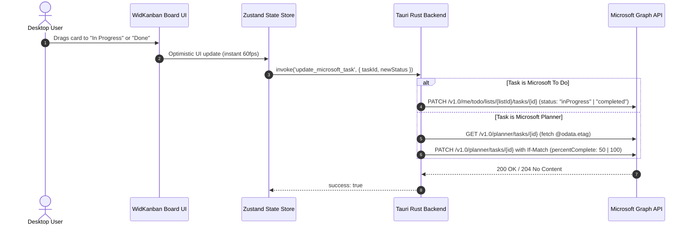

# WidKanban — Microsoft 365 & Teams API Setup Guide

This guide walks you through connecting your **Microsoft 365** and **Microsoft Teams** account to WidKanban. Once configured, WidKanban automatically synchronizes your **Teams for Education Assignments**, **Microsoft Planner** cards, **Microsoft To Do** tasks, and **Outlook Flagged Emails** into a single, unified Kanban board.

> [!NOTE]
> WidKanban **never** stores tokens in your browser or frontend state. Your token is transmitted directly to the native Rust backend and saved securely in local OS storage (`credentials.json`) with restricted file permissions (`600`). All Microsoft Graph HTTP requests are performed natively in Rust with zero webview exposure.

> **Status**: Verified & Active  
> **Last Updated**: October 2026 (Verified with Microsoft Graph Explorer & Entra ID / Azure Portal UI)  
> **Visual Walkthrough Note**: Step-by-step UI screenshots are being added to `docs/images/teams/`. Image anchors (`images/teams/*.png`) are annotated below for each step.

---

## Table of Contents

- [Supported Microsoft 365 Services](#supported-microsoft-365-services)
- [Required Permissions & Scopes](#required-permissions--scopes)
- [Option 1: 60-Second Setup via Microsoft Graph Explorer (Recommended for Quick Start)](#option-1-60-second-setup-via-microsoft-graph-explorer-recommended-for-quick-start)
- [Option 2: Microsoft Entra ID / Azure App Registration (Permanent Desktop Setup)](#option-2-microsoft-entra-id--azure-app-registration-permanent-desktop-setup)
- [Option 3: Developer Environment Variable (`.env`)](#option-3-developer-environment-variable-env)
- [How WidKanban Synchronizes Microsoft Tasks](#how-widkanban-synchronizes-microsoft-tasks)
- [Troubleshooting & FAQ](#troubleshooting--faq)
- [Revoking Access](#revoking-access)
- [Related Documentation](#related-documentation)

---

## Supported Microsoft 365 Services

WidKanban unifies multiple Microsoft work, school, and personal task streams under the **`microsoft_teams`** provider:

| Service | Microsoft Graph Endpoint | WidKanban Features & Badges |
| :--- | :--- | :--- |
| **Teams for Education Assignments** | `GET /v1.0/education/me/assignments` | Ingests assignments and homework with class titles, due dates, instructions preview, and direct submission deep-links (`Assignment` badge). |
| **Microsoft Planner** | `GET /v1.0/me/planner/tasks` | Ingests Kanban cards assigned to you across all Microsoft 365 groups with percent progress (`0%`, `50%`, `100%`) and checklist subtasks (`Planner` badge). |
| **Microsoft To Do** | `GET /v1.0/me/todo/lists/{id}/tasks` | Ingests tasks from your default *Tasks* list and custom lists with subtasks, due dates, and notes. Two-way status write-back supported. |
| **Outlook Flagged Emails** | `GET /v1.0/me/todo/lists/{flaggedListId}/tasks` | Converts flagged email threads into actionable Kanban items with one-click deep links back to Outlook on the web (`Flagged` badge). |

---

## Required Permissions & Scopes

WidKanban requests only delegated permissions needed to display and update your personal tasks:

| Microsoft Graph Scope | Permission Type | Why It Is Needed |
| :--- | :--- | :--- |
| `Tasks.ReadWrite` | Delegated | Read and update tasks in **Microsoft To Do** and **Microsoft Planner** |
| `EduAssignments.ReadBasic` | Delegated | Read assigned class homework and due dates in **Teams for Education** |
| `Group.Read.All` | Delegated | Discover group-associated Planner boards and Teams channels |
| `User.Read` | Delegated | Identify the authenticated Microsoft user account |
| `offline_access` | Delegated | Enables long-lived token refresh |

> [!TIP]
> If you are using a personal Microsoft account (e.g. `@outlook.com`, `@hotmail.com`), `EduAssignments.ReadBasic` will simply return an empty list gracefully, while your **To Do** lists, **Flagged Emails**, and personal **Planner** cards will sync normally.

---

## Option 1: 60-Second Setup via Microsoft Graph Explorer (Recommended for Quick Start)

Microsoft Graph Explorer provides a pre-consented sandbox that generates immediate OAuth 2.0 access tokens without needing an Azure subscription or Cloud tenant registration.

### Step 1: Open Microsoft Graph Explorer
1. Navigate to [Microsoft Graph Explorer](https://developer.microsoft.com/en-us/graph/graph-explorer).
2. Click **Sign in to Graph Explorer** in the top-right corner.
3. Authenticate with your Microsoft personal, work, or university account.


---

### Step 2: Consent to Permissions
1. Under the left sidebar or beside the query bar, click **Modify permissions**.
2. Locate the following scopes and click **Consent**:
   - `Tasks.ReadWrite`
   - `EduAssignments.ReadBasic` (if using a school account)
   - `Group.Read.All`
   - `User.Read`
3. A Microsoft permission consent dialog will appear. Click **Accept**.


---

### Step 3: Copy Your Access Token
1. In Graph Explorer, click the **Access token** tab (located directly below the query box).
2. Click the **Copy token** icon. The token is a standard JWT starting with `eyJ0eXAi...`.


---

### Step 4: Paste into WidKanban
1. Open WidKanban on your desktop.
2. Click the **Settings (⚙)** icon in the header.
3. Scroll to the **Microsoft 365 & Teams** section.
4. Paste your token into the token input field.
5. Click **Save Credentials**.
6. The badge will change to **Connected** (green) and your Microsoft 365 tasks will immediately populate the board!


---

## Option 2: Microsoft Entra ID / Azure App Registration (Permanent Desktop Setup)

For permanent desktop widget usage with an organization or school tenant, you can register an application in the Microsoft Entra Admin Center:

### Step 1: Open Microsoft Entra Admin Center
1. Navigate to the [Microsoft Entra Admin Center](https://entra.microsoft.com/) (or [Azure Portal](https://portal.azure.com/)).
2. Log in with your organization or administrator account.
3. In the left navigation, go to **Identity** → **Applications** → **App registrations**.


---

### Step 2: Register a New Application
1. Click **+ New registration** at the top.
2. Fill in the application fields:
   - **Name**: `WidKanban Desktop Widget`
   - **Supported account types**: Select **Accounts in any organizational directory (Any Microsoft Entra ID tenant - Multitenant) and personal Microsoft accounts (e.g. Skype, Xbox)**.
   - **Redirect URI**: Select platform **Public client/native (mobile & desktop)** and enter:
     ```text
     http://localhost
     ```
3. Click **Register**.


---

### Step 3: Add API Permissions
1. In your newly created app's left menu, click **API permissions**.
2. Click **+ Add a permission**, then select **Microsoft Graph**.
3. Select **Delegated permissions**.
4. Search for and check the following scopes:
   - `Tasks.ReadWrite`
   - `EduAssignments.ReadBasic`
   - `Group.Read.All`
   - `User.Read`
5. Click **Add permissions**.
6. *(Optional for Admins)* Click **Grant admin consent for [Your Organization]** to bypass individual user consent prompts.


---

### Step 4: Configure Desktop Authentication
1. In the left navigation menu, click **Authentication**.
2. Under **Advanced settings** → **Allow public client flows**, toggle **Enable the following mobile and desktop flows** to **Yes**.
3. Click **Save**.


---

## Option 3: Developer Environment Variable (`.env`)

For developers working locally (`npm run tauri dev`), you can bypass the Settings UI entirely by passing your token via a local `.env` file:

1. Create or open `.env` in the project root:
   ```env
   # Microsoft Graph Access Token
   MICROSOFT_TOKEN=eyJ0eXAiOiJKV1QiLC...
   ```
2. Launch WidKanban:
   ```bash
   npm run tauri dev
   ```
3. WidKanban's native Rust backend will detect `MICROSOFT_TOKEN` at startup via `dotenvy`, populate your tasks automatically, and display the purple **`.env`** badge in Settings.
4. The environment token is strictly loaded into memory by Rust and never written to disk or bundled in the webview.

---

## How WidKanban Synchronizes Microsoft Tasks

### Drag-and-Drop Status Synchronization

When you drag a Microsoft card between columns, WidKanban updates the UI with 60fps responsiveness and performs background write-back via Microsoft Graph:



### Status Mapping Reference

| WidKanban Column | Microsoft To Do Status | Microsoft Planner Progress | Teams Assignment Status |
| :--- | :--- | :--- | :--- |
| **To Do** | `notStarted` | `0%` | `assigned` / `scheduled` |
| **In Progress** | `inProgress` | `50%` | In progress |
| **Done** | `completed` | `100%` | `submitted` / `completed` |

---

## Troubleshooting & FAQ

### 1. "Need admin approval" when consenting to permissions
- **Cause**: Some enterprise or university Microsoft Entra tenants enforce strict admin consent policies preventing students and employees from authorizing third-party apps to access organizational data (`EduAssignments.ReadBasic`).
- **Solution**:
  - Request your school/organization IT admin to grant tenant-wide consent for the delegated scope, **OR**
  - Use a personal Microsoft account (`@outlook.com` / `@hotmail.com`) or developer tenant for testing personal To Do and Planner items.

### 2. My token expired after 60–90 minutes
- **Cause**: Microsoft Graph access tokens obtained via Graph Explorer have a standard lifespan of 60 to 90 minutes.
- **Solution**: Return to Graph Explorer, copy a fresh token from the **Access token** tab, and paste it into WidKanban Settings. Permanent refresh token support via native desktop loopback flow is coming in Milestone 4.

### 3. Planner tasks fail to update status (ETag Mismatch)
- **Cause**: Microsoft Planner requires optimistic concurrency via an HTTP `If-Match` header containing the task's latest `@odata.etag`.
- **Solution**: WidKanban's native Rust backend automatically fetches the latest ETag immediately prior to issuing the `PATCH` request, preventing concurrency rejections.

---

## Revoking Access

### From WidKanban
1. Open WidKanban Settings (`⚙`).
2. In the **Microsoft 365 & Teams** section, click the **Trash (Disconnect) icon**.
3. WidKanban will purge the stored Microsoft token from your local OS `credentials.json` file and remove all Microsoft tasks from your board.

### From Your Microsoft Account
1. Visit [Microsoft Account Consent Management](https://account.live.com/consent/Manage).
2. For work/school accounts, visit the [Microsoft My Apps Portal](https://myapplications.microsoft.com/).
3. Locate **Graph Explorer** or **WidKanban** and click **Revoke** / **Remove permissions**.

---

## Related Documentation

- 🐙 **[GitHub Setup Guide](github-setup.md)**: Visual screenshot walkthrough for GitHub Personal Access Tokens.
- 🔵 **[Google Tasks Setup Guide](google-setup.md)**: Setup guide for Google Tasks OAuth 2.0 loopback flow.
- 🔑 **[Credentials Storage & Security Model](credentials-setup.md)**: Detailed overview of local file paths and encryption permissions.
- 🏛️ **[Architecture & System Design](architecture.md)**: Core system architecture, Tauri IPC commands, and schemas.
